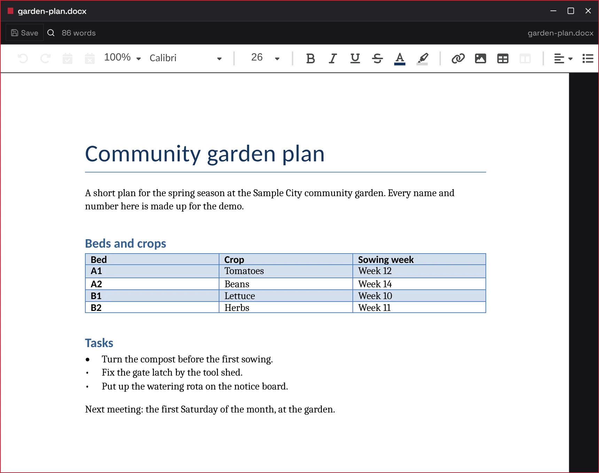
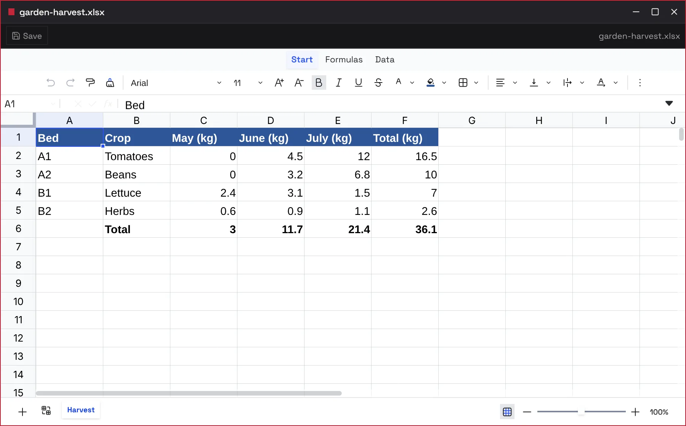
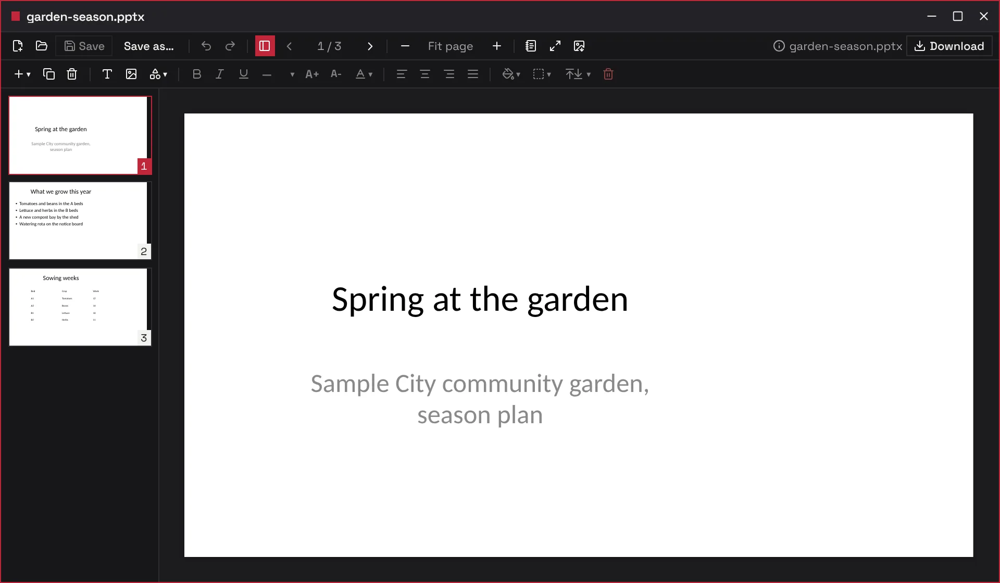
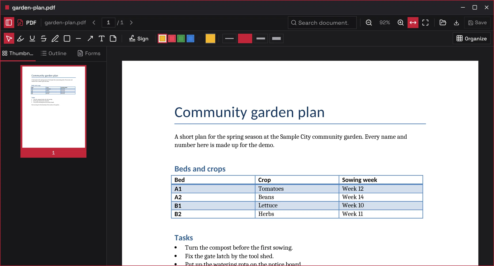
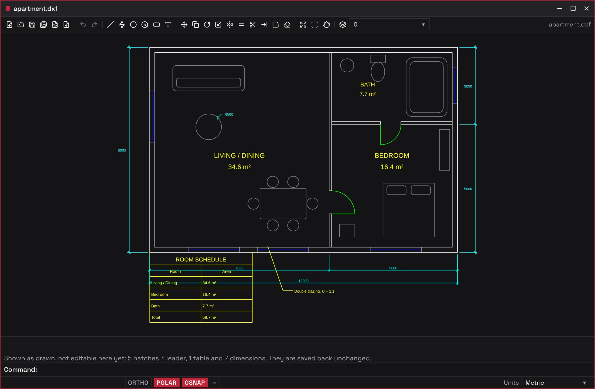
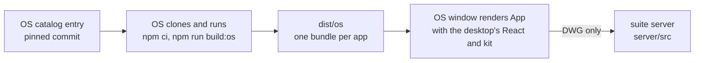

# imbatranim-apps

The apps installed on imbatranimOS, grouped by kind. The first group is Office (renamed from imbatranim-office on 2026-11-06): Docs, Sheets, Slides, PDF and CAD. They install together from the OS's Marketplace and open in OS windows with the desktop's own buttons, dialogs and theme.

<p align="center">
  
</p>

**Status:** Personal project. All five apps are built and were walked inside the OS on 2026-10-28, where they replace the OS's old built-in Docs, Sheets, Slides and PDF apps. It is not published to npm and runs only inside imbatranimOS.

## What it does

- **Docs** edits Word documents (`.docx`) on SuperDoc.
- **Sheets** edits spreadsheets (`.xlsx`, `.xlsm`, `.csv`) on Univer, with formulas computed in a worker. It refuses `.xls` and `.ods` by name rather than open them empty.
- **Slides** opens, edits and presents PowerPoint decks (`.pptx`).
- **PDF** reads, annotates, fills in, signs and reorganises PDF documents.
- **CAD** draws 2D plans with a command line, object snaps and layers, reads and writes DXF, and opens DWG through the suite's server.

Editing runs in the browser, inside the OS window, so files never leave the machine the OS runs on. It is not a standalone web office: the apps need the desktop's React and UI kit, which the OS lends them at runtime.

## Screenshots

| Sheets                                                                                                                                     | Slides                                                                                                                                                                                    |
| ------------------------------------------------------------------------------------------------------------------------------------------ | ----------------------------------------------------------------------------------------------------------------------------------------------------------------------------------------- |
|   |                                                                    |
| **PDF**                                                                                                                                    | **CAD**                                                                                                                                                                                   |
|  |  |

## How it works

Each app is a workspace package that exports one React component. `npm run build:os` bundles them into `dist/os` with React, React DOM and `@imbatranim/ui` left external, so the desktop renders each app with its own instances. A small Fastify server, which the OS starts when an app first asks for it, does one-off jobs that cannot run in the browser, such as turning a DWG into DXF. More in the [wiki's architecture page](corpus/wiki/architecture.md).



## Run it locally

Requires Node 24.14.1 or later and npm 11.11 or later.

```bash
npm ci
npm test               # vitest across the apps, the shared package and the server
npm run typecheck
npm run build:os       # writes dist/os, what the OS's Marketplace installs
```

To try the apps, install the suite into an imbatranimOS you run locally from a commit of your checkout: [os/README.md](os/README.md#installing-from-a-local-checkout). More in [docs/getting-started.md](docs/getting-started.md).

## Project layout

| Path                       | What lives there                                                                 |
| -------------------------- | -------------------------------------------------------------------------------- |
| `apps/`                    | One package per app: `docs`, `sheets`, `slides`, `pdf`, `cad`                    |
| `packages/shared/`         | The OS build, the externals plugin, shared types and a fake system for tests     |
| `packages/pdfcore-engine/` | The PDF engine the PDF app uses                                                  |
| `server/`                  | The suite's Fastify server: health and the DWG to DXF converter                  |
| `vendor/imbatranim-ui/`    | The snapshot of the desktop's UI kit the apps build against (`npm run kit:sync`) |
| `os/`                      | The catalog descriptor template the OS pins, and how to install from a checkout  |
| `corpus/`                  | The project wiki: decisions, status and the briefs                               |

## Docs

- [docs/](docs/README.md): setup and how the images here were made
- [os/README.md](os/README.md): the OS descriptor and a local install
- Project wiki: [corpus/](corpus/index.md) for decisions, status and the work log
- [THIRD-PARTY-NOTICES.md](THIRD-PARTY-NOTICES.md): the notices of code translated from other projects

## License

[AGPL-3.0-only](LICENSE), the same as imbatranimOS.
